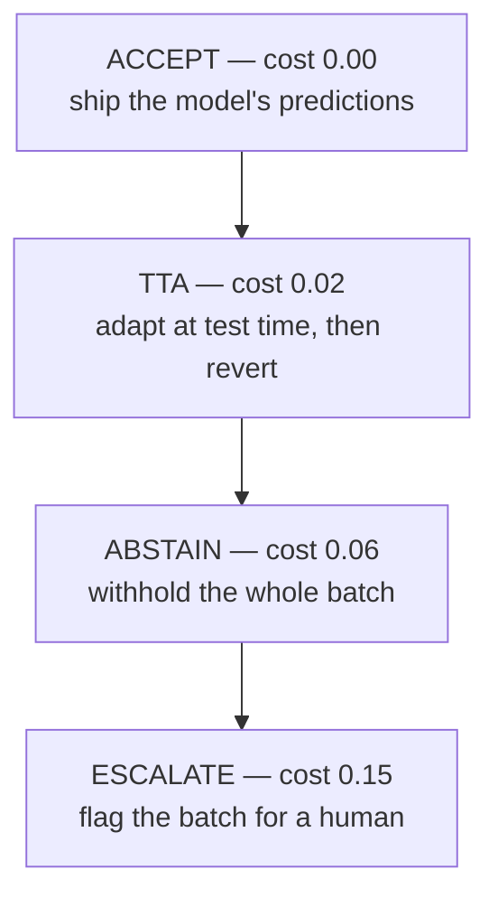
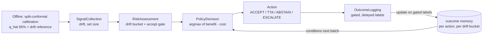

# agentic-runtime-supervisor

**My question is simple: a deployed medical AI drifts and starts making unreliable predictions. When should it intervene?**
Today that decision is a fixed threshold, set once at deployment. This proof-of-concept
tests whether it should be a learned decision instead — and reports, honestly, what
happened when we measured it.

Research PoC. Phase 1: supervision under a stationary stream (complete). Phase 2:
non-stationary shift (in progress). DermaMNIST, one frozen ViT, a synthetic corruption
stream. CPU-only, single command, fully archived.

## The problem: confidently wrong

A classifier under distribution shift does not always fail loudly. In the thesis work
behind this PoC, a supervised ViT-B/16 on DermaMNIST drops from **80.9% to 5.3%
accuracy** under shift while its expected calibration error rises from **0.014 to
0.889**. Below chance on seven classes — not merely degraded, but systematically wrong,
and still confident about it.

That is the dangerous case. A model that failed loudly could be caught by any threshold.
This one fails silently, because **the signal you would normally monitor — the model's
own confidence — is the signal that has been corrupted.** A static confidence threshold
is blindest exactly when it matters most.

## Why it is a decision problem

Facing possible shift, the system has four actions, with steeply asymmetric costs:

| Action | Cost | What it does |
|---|---|---|
| ACCEPT | 0.00 | ship the model's predictions |
| TTA | 0.02 | adapt at test time (LayerNorm entropy), then revert |
| ABSTAIN | 0.06 | withhold the whole batch |
| ESCALATE | 0.15 | flag the batch for a human, who returns labels |



Costs are in ECE units; the ordering (free < cheap compute < lost throughput < human
time) carries the argument, not the magnitudes. Down the ladder, throughput falls and
oversight rises. A fixed rule picks one rung once. The supervisor re-picks every batch.

## The supervisor

On each batch, the supervisor reads three **label-free** signals:

1. **Embedding drift** versus a clean-calibration reference.
2. **Conformal prediction set size** under the frozen model.
3. **Expected benefit minus cost**, estimated online from past outcomes.

It then picks the action with the highest **estimated benefit − cost**. Benefit is a
running, per-action, per-drift-bucket estimate of realized ECE reduction; selection is
ε-greedy. Feedback is **delayed and action-gated** — labels arrive only from escalations
and a fixed ~10% labeled monitoring subset, never from ordinary accepted batches. The
policy is a simple frequency estimator, deliberately not a learned or RL policy.

**No LLM calls anywhere.** LangGraph is only the state-machine substrate; every node is
plain Python.



## The experiment

One stream (200 batches × 64, seed 0) runs through the supervisor and five comparators:

| Comparator | Policy |
|---|---|
| Static classifier | raw frozen model, no conformal wrapper, never intervenes |
| Never-TTA | conformal-wrapped, always accepts |
| Always-TTA | adapts on every batch |
| Fixed-threshold monitor | drift threshold, oracle-tuned on the eval stream (an upper bound for static rules) |
| Contextual bandit | memoryless; same signals, same gated labels, no per-bucket memory |

The metric is **net calibration benefit** = realized ECE reduction − intervention cost,
computed identically for every method. Three questions:

- **RQ1** — does the supervisor beat the best-tuned static policy?
- **RQ2** — does bucketed outcome memory beat the memoryless bandit on the same signals?
- **RQ3** — does adapt-then-recalibrate preserve 95% conformal coverage under TTA?

## Results

An honest null. The full table and readouts are in [RESULTS.md](RESULTS.md).

| Method | Net calibration benefit |
|---|---|
| Static classifier | 0.0000 |
| Never-TTA | 0.0000 |
| Fixed-threshold monitor (oracle-tuned) | 0.0000 |
| Contextual bandit (memoryless) | -0.0064 |
| Supervisor (ours) | -0.0074 |
| Always-TTA | -0.0263 |

- **RQ1 — negative.** On this stream no intervention clears its cost bar: LayerNorm-entropy
  TTA *worsens* calibration by sharpening confidence. So the oracle-tuned monitor collapses
  to "never intervene" (0.0000), and the supervisor (-0.0074) cannot beat it.
- **RQ2 — null, across 5 seeds.** Supervisor -0.0091 ± 0.0020 versus bandit
  -0.0077 ± 0.0031; the sign of the gap flips across seeds (1 of 5 favor the supervisor).
  A tie. Bucketed memory did not beat a stationary linear reward surface here.
- **Ablation: the gap is mostly ESCALATE's cost.** Removing the outcome-estimator loop
  leaves a fixed threshold map. As pre-registered (bucket 2 → ESCALATE), that costs
  **+0.041 ± 0.009** net versus the supervisor across the same 5 seeds. But without the
  loop, ESCALATE is strictly dominated by ABSTAIN (same benefit, higher cost). With
  bucket 2 → ABSTAIN, a variant I added post hoc, the gap shrinks to **+0.004 ± 0.004**.
  That is not clearly positive. About 90% of the specified gap comes from ESCALATE's
  cost, not from the outcome memory.
- **Gate finding.** A severity sweep confirms TTA *does* recover real accuracy under
  gaussian noise (+2.1 to +2.7 points). But its best-case ECE gain (+0.0152) sits below
  the TTA cost (0.02), so the calibration-based metric is **structurally blind** to that
  recovery: a calibration-driven supervisor correctly declines an intervention that would
  have improved accuracy. Which benefit to measure is itself the open question.

## Next: Phase 2, non-stationary shift

- **Phase 1 finding.** On a stationary stream, never intervening was the best policy.
  Every acting policy (supervisor, bandit, Always-TTA) came out net negative.
- **Why this is expected.** Episodic TTA makes the reward surface stationary. Memory over
  past interventions has nothing to learn from.
- **Phase 2 stream.** Gradual, accumulating shift, such as progressive scanner or site
  drift, instead of episodic batches.
- **Phase 2 metric.** A benefit definition that also captures accuracy recovery. ECE alone
  is structurally blind to what TTA recovers.
- **Long-term goal.** Retrospective validation on real clinical data.
- If your lab works on distribution shift, TTA, conformal prediction, or safe deployment
  of medical AI, feel free to reach out:
  [LinkedIn](https://www.linkedin.com/in/asfand-yar-3966b8291).

## The result I am most confident in: the artifact catch

An earlier configuration had the supervisor winning — **+0.0496** net versus +0.0028 for
the then-monitor. A three-run audit traced that entire advantage to two evaluation
artifacts, not to the supervisor:

1. A **small-sample ECE noise floor** (≈0.11 at batch size 64) was being credited to the
   withhold actions, paying every policy to abstain on well-calibrated batches.
2. The **fixed-threshold monitor was denied the ABSTAIN action** — the very action the
   first artifact made profitable — so the baseline was handicapped.

Both were corrected. The supervisor's advantage went from **+0.0496 to -0.0074**: the
apparent win was measurement error, and the honest number is the null above. A comparison
that survives its own artifact audit is worth more than a win that does not.

## What this means for the research agenda

- **Non-stationarity.** Episodic TTA reverts after every batch, so the reward surface is
  effectively stationary — which removes the strongest reason to prefer a memoryful
  controller over a bandit. Continual TTA, where adapted weights persist, is where memory
  should begin to pay.
- **Benefit definition.** The gate finding shows calibration-value and accuracy-value can
  diverge. How to define intervention benefit when they do is an open question — not
  something to settle by swapping the metric mid-experiment.
- **Conformal under a changing score.** Adapt-then-recalibrate is a flagged simplification,
  not a fix. Whether conformal validity survives a scoring function that drifts as the
  model adapts is the open theoretical question.

## Reproduce

```bash
uv sync
uv run ars-reproduce
```

Trains the ViT if no checkpoint exists (~3 min CPU), calibrates, then streams 200
corrupted batches through the supervisor and five comparators, plus ablations (three
signal ablations, escalation-VoI bonus, recalibration on/off). It writes per-batch
decision traces to `runs/*.jsonl` and regenerates [RESULTS.md](RESULTS.md). Everything is
seeded (seed 0) and CPU-only; the whole pipeline finishes in minutes. Each run archives
its traces (one JSONL per method + `summary.json`) to the committed `results/seed<seed>/`
folder, so the Phase 1 experiment's per-batch decisions are inspectable without
re-running.

## Repo map

- `docs/` — planning documents (requirements, architecture, design, rules, phases,
  decision log). `docs/design.md` specifies the policy precisely; `docs/memory.md` logs
  every design decision, with rejected alternatives.
- `src/ars/` — `policy.py` (outcome-estimator policy — the core), `graph.py` (LangGraph
  nodes), `tta.py` (episodic LayerNorm-only TTA + adapt-then-recalibrate), `conformal.py`,
  `signals.py`, `baselines.py`, `runner.py` (label-path-separated harness), `report.py`,
  `reproduce.py`.
